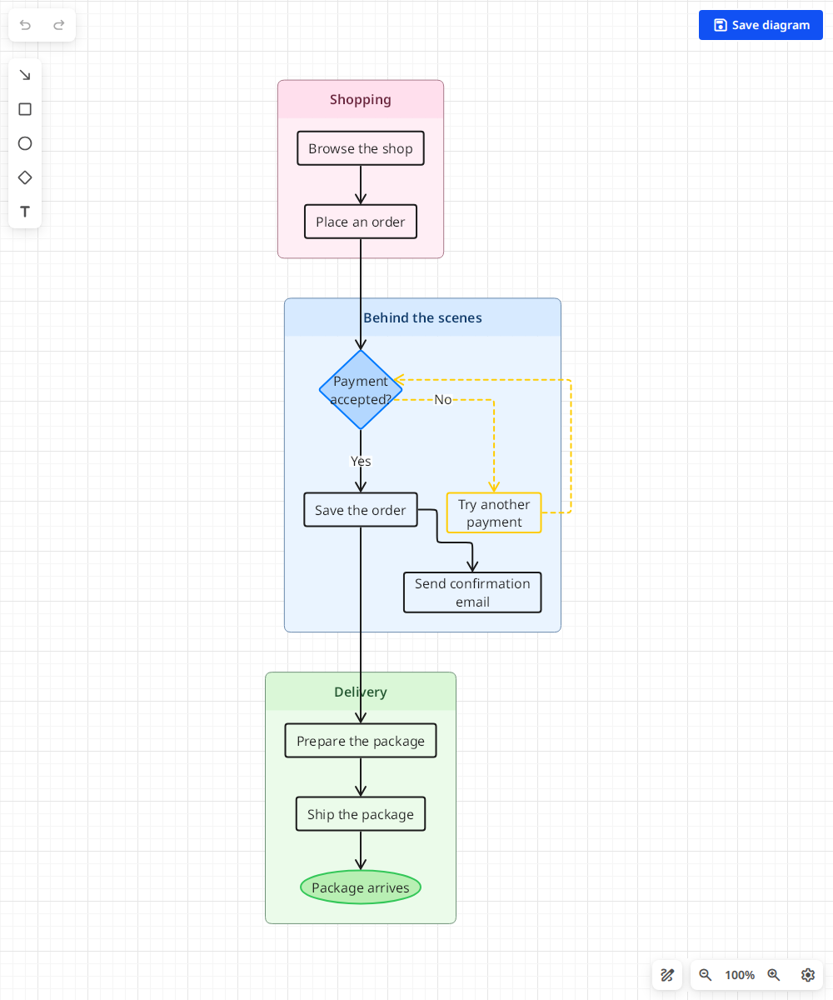

# DrawMotive for VS Code

**Make your ideas easy to understand.**

Describe a process in TextGraph. Refine it on a canvas in VS Code. Share it as an image.

[Get DrawMotive](https://github.com/drawmotive/vscode-drawmotive/releases) · [Try the text → diagram demo](https://textgraph.dev/playground#source=shopping%28info%29%3A%20Shopping%20%7B%0A%20%20browse%20-%3E%20checkout%0A%20%20browse%3A%20Browse%20the%20shop%0A%20%20checkout%3A%20Place%20an%20order%0A%7D%0A%0Aprocessing%28primary%29%3A%20Behind%20the%20scenes%20%7B%0A%20%20payment%20-%3E%20saved%20%3A%20Yes%0A%20%20payment%20-%3E%28dashed%20warning%29%20retry%20%3A%20No%0A%20%20retry%20-%3E%28dashed%20warning%29%20payment%0A%20%20saved%20-%3E%20email%0A%0A%20%20payment%28diamond%20fill%20primary%29%3A%20Payment%5Cnaccepted%3F%0A%20%20retry%28warning%29%3A%20Try%20another%5Cnpayment%0A%20%20saved%3A%20Save%20the%20order%0A%20%20email%3A%20Send%20confirmation%5Cnemail%0A%7D%0A%0Adelivery%28success%29%3A%20Delivery%20%7B%0A%20%20pack%20-%3E%20ship%20-%3E%20arrived%0A%20%20pack%3A%20Prepare%20the%20package%0A%20%20ship%3A%20Ship%20the%20package%0A%20%20arrived%28ellipse%20fill%20success%29%3A%20Package%20arrives%0A%7D%0A%0Acheckout%20-%3E%20payment%0Asaved%20-%3E%20pack%0A) · [Get the editable example](examples/online-order.draw.png)



A familiar story, ready to make your own. [View the full diagram](docs/images/online-order.png).

## Make it yours in a minute

1. Install the latest VSIX from [Releases](https://github.com/drawmotive/vscode-drawmotive/releases) with **Extensions: Install from VSIX…**. Stable versions are also on the [VS Code Marketplace](https://marketplace.visualstudio.com/items?itemName=drawmotive.vscode-drawmotive).
2. Save [online-order.draw.png](examples/online-order.draw.png) to your workspace and open it in VS Code.
3. Change **Package arrives** to **Delivered**, then click **Save diagram**.

Put the PNG in your README or share it with your team. Open the same file in DrawMotive whenever the story changes.

## Start with text. Finish with your own touch.

[Edit this example in the TextGraph playground](https://textgraph.dev/playground#source=shopping%28info%29%3A%20Shopping%20%7B%0A%20%20browse%20-%3E%20checkout%0A%20%20browse%3A%20Browse%20the%20shop%0A%20%20checkout%3A%20Place%20an%20order%0A%7D%0A%0Aprocessing%28primary%29%3A%20Behind%20the%20scenes%20%7B%0A%20%20payment%20-%3E%20saved%20%3A%20Yes%0A%20%20payment%20-%3E%28dashed%20warning%29%20retry%20%3A%20No%0A%20%20retry%20-%3E%28dashed%20warning%29%20payment%0A%20%20saved%20-%3E%20email%0A%0A%20%20payment%28diamond%20fill%20primary%29%3A%20Payment%5Cnaccepted%3F%0A%20%20retry%28warning%29%3A%20Try%20another%5Cnpayment%0A%20%20saved%3A%20Save%20the%20order%0A%20%20email%3A%20Send%20confirmation%5Cnemail%0A%7D%0A%0Adelivery%28success%29%3A%20Delivery%20%7B%0A%20%20pack%20-%3E%20ship%20-%3E%20arrived%0A%20%20pack%3A%20Prepare%20the%20package%0A%20%20ship%3A%20Ship%20the%20package%0A%20%20arrived%28ellipse%20fill%20success%29%3A%20Package%20arrives%0A%7D%0A%0Acheckout%20-%3E%20payment%0Asaved%20-%3E%20pack%0A), or use the same source in [TextGraph Markdown Preview](https://marketplace.visualstudio.com/items?itemName=drawmotive.textgraph-markdown).

<details>
<summary>Copy the complete TextGraph source</summary>

```textgraph
shopping(info): Shopping {
  browse -> checkout
  browse: Browse the shop
  checkout: Place an order
}

processing(primary): Behind the scenes {
  payment -> saved : Yes
  payment ->(dashed warning) retry : No
  retry ->(dashed warning) payment
  saved -> email

  payment(diamond fill primary): Payment\naccepted?
  retry(warning): Try another\npayment
  saved: Save the order
  email: Send confirmation\nemail
}

delivery(success): Delivery {
  pack -> ship -> arrived
  pack: Prepare the package
  ship: Ship the package
  arrived(ellipse fill success): Package arrives
}

checkout -> payment
saved -> pack
```

[Source file](examples/online-order.textgraph)

</details>

The downloadable drawing was generated from this source. Canvas changes are saved in the drawing; they do not rewrite the text.

For a blank canvas, run **DrawMotive: New Diagram** and save as `your-idea.draw.png`.

Works offline, without an account. Requires VS Code 1.95 or newer on Windows, macOS, or Linux.

[Report an issue](https://github.com/drawmotive/vscode-drawmotive/issues) · [Development](docs/development.md) · [Contributing](CONTRIBUTING.md) · [Release notes](CHANGELOG.md)
